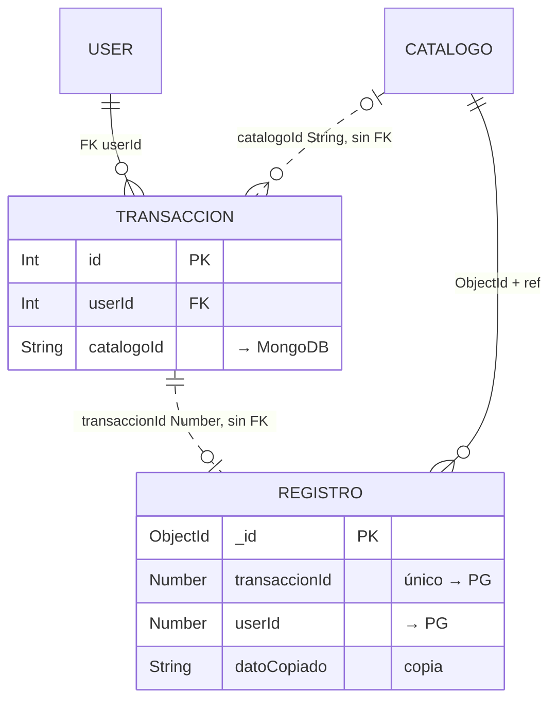

# Tarea individual U2 · Modelo híbrido PostgreSQL + MongoDB

**Estudiante:** ______  **N.º de lista:** ___  **Caso:** ___ · ______

> Mismo formato que el workload del material de Modelado (lección 2.2) y que el ejemplo resuelto de la clínica
> (`docs/ejemplo_clinica/Workload_clinica_hibrida.md`). Cada operación agrega la fila **Base**.

## 1. Workload

### 1.1 Casos de uso
-

### 1.2 Datos principales (cuántos actores, cuántos registros, cuánto tiempo se guardan)
-

### 1.3 Suposiciones (lo que puede cambiar)
-

### 1.4 Operaciones (mínimo 6, una tabla por operación)

| Actor: | |
|---|---|
| Descripción: | |
| Tipo de operación: | Lectura / Escritura |
| Datos en la operación: | |
| Frecuencia: | |
| Tasa: | |
| Base: | PostgreSQL / MongoDB / Las dos (y por qué) |

| Actor: | |
|---|---|
| Descripción: | |
| Tipo de operación: | Lectura / Escritura |
| Datos en la operación: | |
| Frecuencia: | |
| Tasa: | |
| Base: | PostgreSQL / MongoDB / Las dos (y por qué) |

| Actor: | |
|---|---|
| Descripción: | |
| Tipo de operación: | Lectura / Escritura |
| Datos en la operación: | |
| Frecuencia: | |
| Tasa: | |
| Base: | PostgreSQL / MongoDB / Las dos (y por qué) |

| Actor: | |
|---|---|
| Descripción: | |
| Tipo de operación: | Lectura / Escritura |
| Datos en la operación: | |
| Frecuencia: | |
| Tasa: | |
| Base: | PostgreSQL / MongoDB / Las dos (y por qué) |

| Actor: | |
|---|---|
| Descripción: | |
| Tipo de operación: | Lectura / Escritura |
| Datos en la operación: | |
| Frecuencia: | |
| Tasa: | |
| Base: | PostgreSQL / MongoDB / Las dos (y por qué) |

| Actor: | |
|---|---|
| Descripción: | |
| Tipo de operación: | Lectura / Escritura |
| Datos en la operación: | |
| Frecuencia: | |
| Tasa: | |
| Base: | PostgreSQL / MongoDB / Las dos (y por qué) |

### 1.5 Entidades

- **PostgreSQL**
  -
- **MongoDB**
  -
- **Entre bases (sin FK)**
  -

### 1.6 Observaciones (qué domina: lectura o escritura, qué crece sin límite, qué necesita integridad)
-

## 2. ¿PostgreSQL o MongoDB?

| Entidad | ¿Transacciones o choques? | ¿Otras dependen por FK? | ¿Forma variable? | ¿Crece sin límite? | ¿Se lee mucho más? | Base |
|---|---|---|---|---|---|---|
| | | | | | | |
| | | | | | | |
| | | | | | | |

## 3. Relaciones dentro de MongoDB: embeber o referenciar

| Relación | Cardinalidad | ¿Se lee junto? | ¿Cambia seguido? | ¿Crece sin límite? | Decisión |
|---|---|---|---|---|---|
| | | | | | |

## 4. ERD híbrido (notación pata de gallo, como el material 2.1)

Dos zonas, PostgreSQL y MongoDB; cada entidad con sus campos y tipos; lo embebido dentro de la entidad (`campo: [Tipo]`).
Línea continua: FK de PostgreSQL o `ref` de Mongoose. **Línea punteada: referencia entre bases** (sin FK).
Puede entregarlo como imagen (draw.io, Lucidchart) o con Mermaid, que GitHub dibuja solo:

## 5. Referencias

| Referencia | Se guarda como | La garantiza | Se une con |
|---|---|---|---|
| | | | |

## 6. Dato copiado entre bases (desnormalización)

- Dato:
- Por qué (operación del workload):
- Costo:

## 7. Endpoints

| Método y ruta | Base(s) | Respuestas posibles |
|---|---|---|
| | | |
